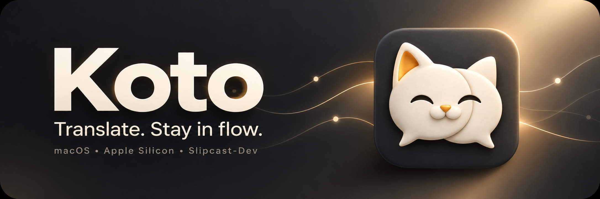

[Русский](README.md) | **English**

Current release: **1.0.0**, Chrome **0.1.4**.

<p align="center"></p>
<p align="center">   </p>

# Koto · Slipcast-Dev

A native macOS translator for text, selections and screen regions, with local engines and Chrome and Safari extensions. **Translate. Stay in flow.**

**[Download DMG](https://github.com/Slipcast-dev/translator-Koto/releases/download/v1.0.0/Koto-1.0.0-20-arm64.dmg)** · [Chrome 0.1.4 ZIP](https://github.com/Slipcast-dev/translator-Koto/releases/download/v1.0.0/Koto-Chrome-0.1.4.zip) · [Releases](https://github.com/Slipcast-dev/translator-Koto/releases) · [Installation](Docs/INSTALLATION.en.md) · [Build from source](Docs/BUILDING.en.md) · [Project status](Docs/STATUS.en.md)

> Release for Apple Silicon. Ad hoc signing, without Apple Developer ID or notarization: macOS may block launch. Release checks were performed on M1 / macOS 27.2; macOS 26 remains untested.

## Features

| Feature | Implementation |
| --- | --- |
| Manual translation | On-device Apple Translation; optional Qwen |
| Selected text | Accessibility, `⌃⌥⌘T` |
| Screen-region OCR | On-device Vision, `⌃⌥⌘R` |
| Live | Live translation, `⌃⌥⌘L`; endurance testing remains pending |
| Chrome and Safari | Translate selections and visible fragments through the included extensions (Safari: build verified, behaviour in Safari not yet tested) |
| Updates | Check and install from GitHub Releases with one button in Settings |
| Tools | Exact phrases, opt-in translation memory, speech and local explanations |
| Cloud | Google/Yandex adapters with a Keychain-stored key; real accounts have not been validated |

## No bundled model weights

**Git, the app and the DMG contain no model weights.** For Qwen, click **Install model** in Settings. The selected model is **Qwen3 4B Instruct 2507 · Q4_K_M**: about **2.50 GB**, Apache 2.0, minimum 8 GiB RAM. Downloads are checked against the expected size and SHA-256; progress, cancellation and removal are available. Weights are stored only in the user's Application Support directory, outside the project. [Model selection and quality →](Docs/MODELS.en.md)

Apple Translation uses system language resources. If they are unavailable, Koto offers explicit preparation. If the system framework fails after a successful availability check, Koto keeps the resolved language pair and offers the same explicit preparation.

## Privacy

Selection capture and OCR require macOS permissions; screenshots are not saved. The browser sends text only after a user action and does not replace original DOM text nodes. Cloud submission from capture/browser/Live requires separate switches. There is no automatic fallback to cloud translation. Translation memory is off by default. [Details →](Docs/PRIVACY.en.md)

## Build

```sh
git clone --recurse-submodules https://github.com/Slipcast-dev/translator-Koto.git
cd translator-Koto
./script/build_local_runtime.sh
./script/build_native_host.sh
KOTO_CONFIGURATION=Release ./script/build_and_run.sh --build-only
python3 script/package_release.py
```

Requires Xcode with a suitable macOS SDK, Swift 6, Apple Silicon and Python 3. The runtime is built from pinned llama.cpp sources. Building does not download model weights. [Instructions →](Docs/BUILDING.en.md)

## Verification and limitations


The root cause of the intermittent initial Apple framework failure is unknown. Koto's recovery handling has been fixed. Live endurance, sleep/wake, macOS 26 and some external integrations still require acceptance testing.

[Report a bug](https://github.com/Slipcast-dev/translator-Koto/issues/new/choose) · [Contributing](CONTRIBUTING.en.md) · [Security](SECURITY.en.md) · [Changelog](CHANGELOG.en.md)

© 2026 **Slipcast-Dev**. All rights reserved: Koto's own code is under a [proprietary license](LICENSE) — modifying or distributing it without the author's written consent is not allowed; using the official releases on your own devices is. [Community code of conduct](CODE_OF_CONDUCT.md). Third-party components retain their [licenses](THIRD_PARTY_NOTICES.en.md).

Release files are built from source and attested. Verify a downloaded file: `gh attestation verify PATH --repo Slipcast-dev/translator-Koto --signer-workflow Slipcast-dev/translator-Koto/.github/workflows/build-artifacts.yml --source-ref refs/heads/main`. Releases are created automatically: changing `CURRENT_PROJECT_VERSION` in `Config/Product.xcconfig` on `main` triggers the build, attestation and release publication ([process](Docs/BUILDING.en.md#release)).
