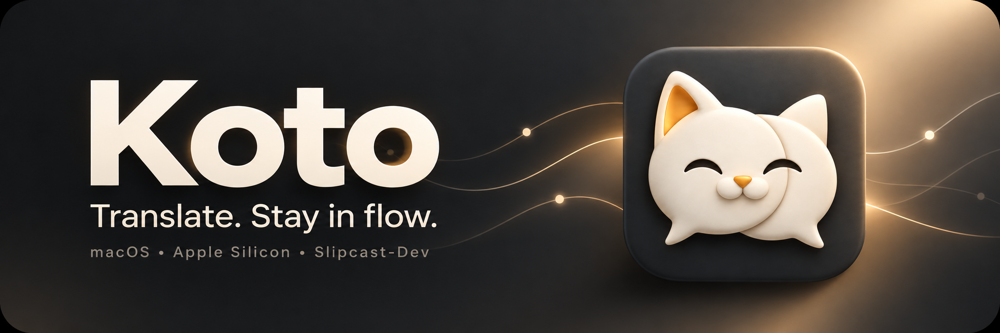

[Русский](README.md) | **English**

<p align="center"></p>
<p align="center">   </p>

# Koto · Slipcast-Dev

A native macOS translator for text, selections and screen regions, with local engines and a Chrome extension. **Translate. Stay in flow.**

**[Download DMG](https://github.com/Slipcast-dev/translator-Koto/releases/download/v0.1.0-alpha.11/Koto-0.1.0-alpha-11-arm64-preview.dmg)** · [Releases](https://github.com/Slipcast-dev/translator-Koto/releases) · [Installation](Docs/INSTALLATION.en.md) · [Build from source](Docs/BUILDING.en.md) · [Project status](Docs/STATUS.en.md)

> Alpha preview for Apple Silicon. Ad hoc signing, without Apple Developer ID or notarization: macOS may block launch. Runtime checks were performed on M1 / macOS 27.0.1; macOS 26 remains untested.

## Features

| Feature | Implementation |
| --- | --- |
| Manual translation | On-device Apple Translation; optional Qwen |
| Selected text | Accessibility, `⌃⌥⌘T` |
| Screen-region OCR | On-device Vision, `⌃⌥⌘R` |
| Live | Live translation, `⌃⌥⌘L`; endurance testing remains pending |
| Chrome | Translate selections and visible fragments through the included extension |
| Tools | Exact phrases, opt-in translation memory, speech and local explanations |
| Cloud | Google/Yandex adapters with a Keychain-stored key; real accounts have not been validated |

## No bundled model weights

**Git, the app and the DMG contain no model weights.** For Qwen, click **Install model** in Settings. The selected model is **Qwen3 4B Instruct 2507 · Q4_K_M**: about **2.50 GB**, Apache 2.0, minimum 8 GiB RAM. Downloads are checked against the expected size and SHA-256; progress, cancellation and removal are available. Weights are stored only in the user's Application Support directory, outside the project. [Model selection and quality →](Docs/MODELS.en.md)

Apple Translation uses system language resources. If they are unavailable, Koto offers explicit preparation. Build 11 also handles a session reporting missing resources after a successful availability check, preserving the resolved language pair.

## Privacy

Selection capture and OCR require macOS permissions; screenshots are not saved. The browser sends text only after a user action and does not replace original DOM text nodes. Cloud submission from capture/browser/Live requires separate switches. There is no automatic fallback to cloud translation. Translation memory is off by default. [Details →](Docs/PRIVACY.en.md)

## Build

```sh
git clone --recurse-submodules https://github.com/Slipcast-dev/translator-Koto.git
cd translator-Koto
./script/build_local_runtime.sh
./script/build_native_host.sh
KOTO_CONFIGURATION=Release ./script/build_and_run.sh --build-only
python3 script/package_release.py
```

Requires Xcode with a suitable macOS SDK, Swift 6, Apple Silicon and Python 3. The runtime is built from pinned llama.cpp sources. Building does not download model weights. [Instructions →](Docs/BUILDING.en.md)

## Verification and limitations

Build 11 passed 21 state-machine tests, 18 protocol checks, 22 AF_UNIX/native-host integrations, 3 real Apple translation scenarios, a Release build, strict signature verification and a model-free DMG check. Physical selection/OCR and real Chrome popup checks have separate version boundaries: [status matrix](Docs/STATUS.en.md), [results](Docs/validation/results.json).

The root cause of the intermittent initial Apple framework failure is unknown. Koto's recovery handling has been fixed. Live endurance, sleep/wake, macOS 26 and some external integrations still require acceptance testing.

[Report a bug](https://github.com/Slipcast-dev/translator-Koto/issues/new/choose) · [Contributing](CONTRIBUTING.en.md) · [Security](SECURITY.en.md) · [Changelog](CHANGELOG.en.md)

© 2026 **Slipcast-Dev**. No separate license terms or LICENSE file have been provided for first-party code. Third-party components retain their licenses: [THIRD_PARTY_NOTICES.en.md](THIRD_PARTY_NOTICES.en.md). The icon and banner are AI-assisted artwork based on the author's selected concept.
